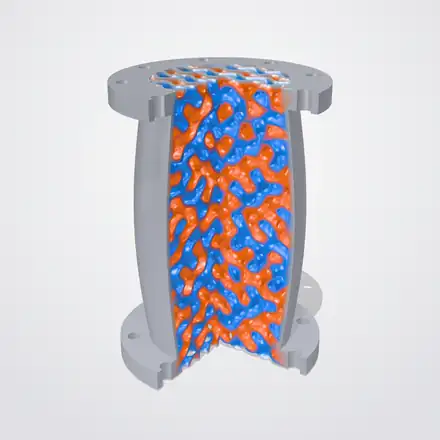
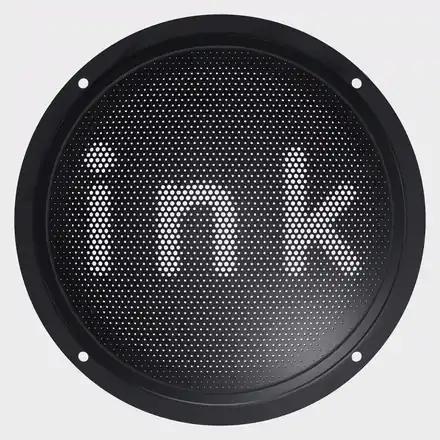
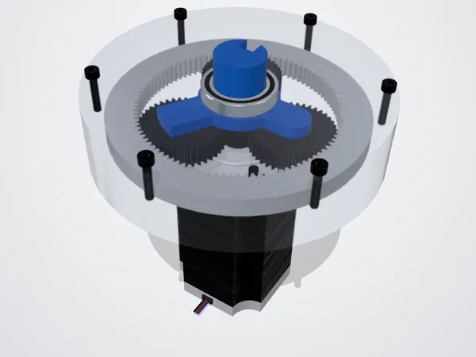
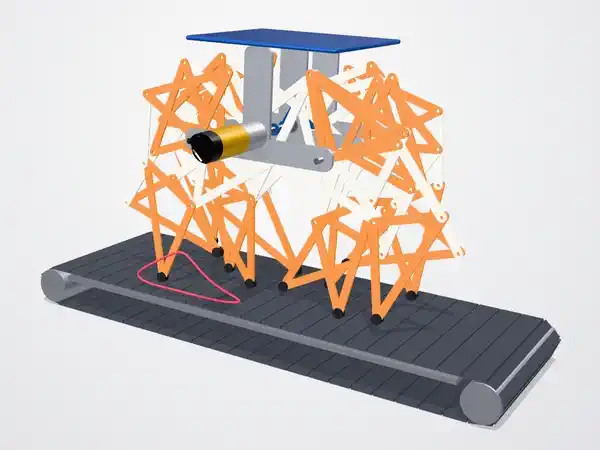
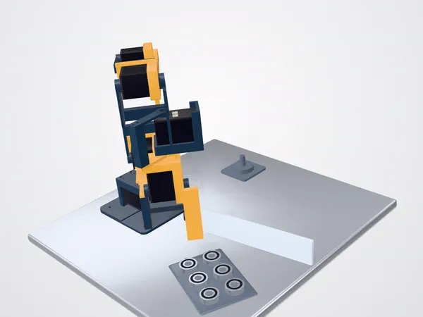
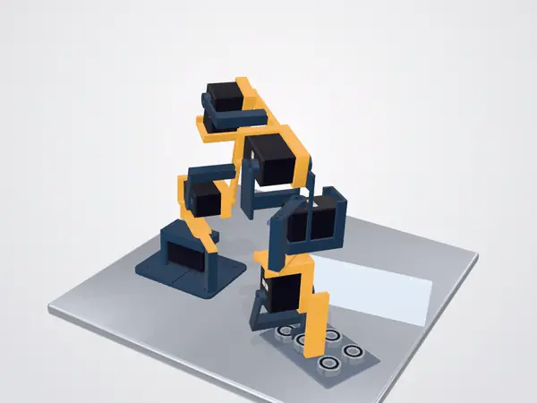

<picture>
  <source media="(prefers-color-scheme: dark)" srcset="https://ink.build/brand/header.svg?theme=dark">
  
</picture>

**An open-source implicit CAD kernel for agents.**

## What you can do with it

### Lattices and blends

Gyroids, graded lattices and thousands of holes are each a line of code.
Blends and shells always build.

 

### Assemblies that move

Joints, linkages and gear trains in motion, checked for collisions.

 

### Proven checks

Clearance and collision checks, proven at every point. A failure comes
with the exact point and moment.

 

### Export

STL, 3MF and GLB meshes, and DXF outlines to cut. More formats are coming.

## What's in the box

- `ink`: the command line and MCP server
- The `.ink` language and its standard library: gears, threads, belts,
  lattices, sheet metal and more
- [Examples](examples/) and [benchmarks](benchmarks/)
- [What ink's answers promise](docs/CORE.md)
- [Contributing](CONTRIBUTING.md)

## Try it

[ink.build](https://ink.build) runs ink and has 27,000 real parts to
build with.

####  Claude Code

<!-- not run: it changes your agent's settings -->
```sh
claude mcp add --transport http ink https://ink.build/mcp
```

#### <picture><source media="(prefers-color-scheme: dark)" srcset="https://cdn.jsdelivr.net/npm/@lobehub/icons-static-png@2.6.0/dark/openai.png"></picture> Codex

<!-- not run: it changes your agent's settings -->
```sh
codex mcp add ink --url https://ink.build/mcp
```

#### Any other MCP client

If it supports remote servers with sign-in, add:

<!-- not run: an address -->
```text
https://ink.build/mcp
```

Then ask your agent for a part. The [guide](docs/GUIDE.md) shows how to
direct it.

To run ink yourself instead, build it (Rust 1.95 or newer) and add
`target/release/ink mcp` to your agent as a local MCP server:

<!-- not run: it builds the binary the tests run -->
```sh
cargo build --release
```

## License

MIT. See [LICENSE](LICENSE).
