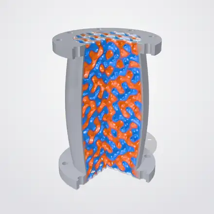
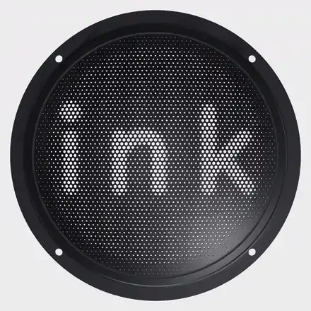
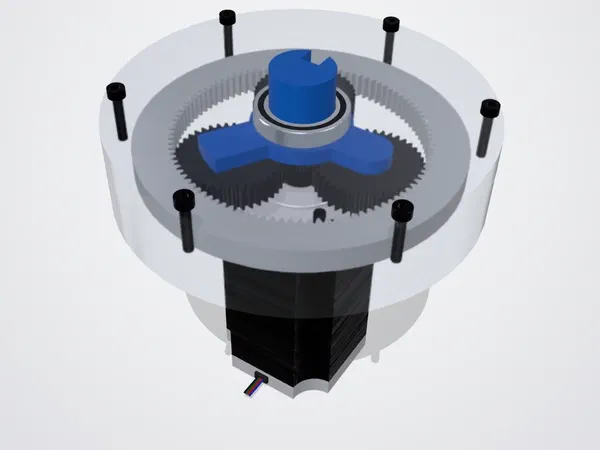
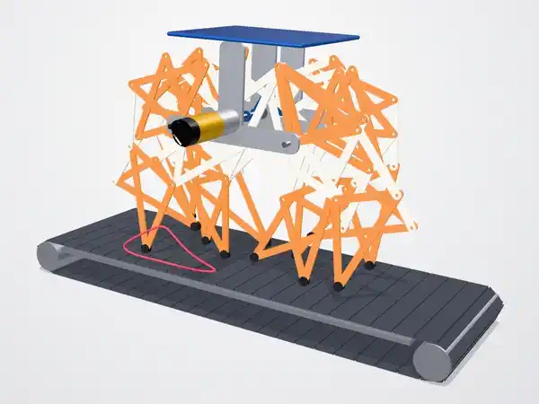
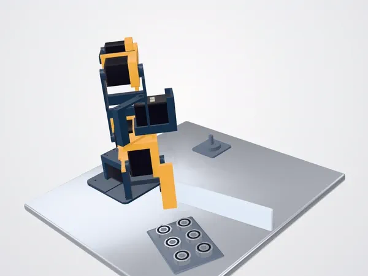
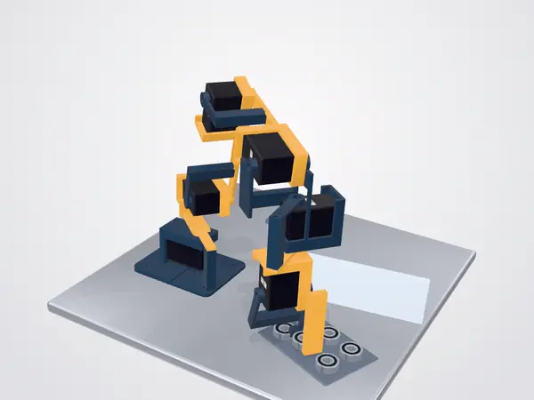

<picture>
  <source media="(prefers-color-scheme: dark)" srcset="https://ink.build/brand/header.svg?theme=dark">
  
</picture>

**An open-source implicit CAD kernel for agents.**

## What you can do with it

### Lattices and blends

Gyroids, graded lattices and thousands of holes are each a line of code.

 

### Assemblies that move

Joints, linkages and gear trains in motion, checked for collisions.

 

### Proven checks

Clearance and collision checks prove claims over the whole continuous motion, not just at sampled frames. When one fails, ink gives the point and, for moving parts, the moment.

 

### Simulation

Strength, stiffness, buckling, vibration modes and steady or transient heat on the field itself, with no mesh. Topology optimization lays out a part within a volume budget. Inverse dynamics computes joint loads, speeds and motor efforts over a motion and checks motor, gearbox and bearing ratings. Every answer says how it was found and how far to trust it.

### Export

STL, 3MF and GLB meshes, and DXF outlines for cutting.

## Try it

[ink.build](https://ink.build) runs ink and has 27,000 real parts to build with.

####  Claude Code

```sh
claude mcp add --transport http ink https://ink.build/mcp
```

#### <picture><source media="(prefers-color-scheme: dark)" srcset="https://cdn.jsdelivr.net/npm/@lobehub/icons-static-png@2.6.0/dark/openai.png"></picture> Codex

```sh
codex mcp add ink --url https://ink.build/mcp
```

#### Any other MCP client

If it supports remote servers with sign-in, add:

```text
https://ink.build/mcp
```

Then ask your agent for a part. The [guide](kernel/docs/GUIDE.md) shows how to direct it.

## Build from source

Requires Rust 1.95 or newer. The repository holds two Cargo workspaces:

| Folder | What's inside |
|---|---|
| [kernel/](kernel/) | The implicit CAD engine, the `.ink` language and standard library, and `ink` (CLI and MCP server). |
| [sim/](sim/) | Simulation packages built on the kernel (FEA studies, topology optimization and dynamics) in one combined `ink` binary. [Sim README](sim/README.md). |

Local builds run without the hosted parts catalog or share links. To run ink locally with simulation included, build `sim/`, put `sim/target/release` on your `PATH` (or use its full path), and add `ink mcp` as a local MCP server:

```sh
(cd sim && cargo build --release)
```

Or build the kernel alone (`kernel/target/release/ink`):

```sh
(cd kernel && cargo build --release)
```

Run tests from either folder:

```sh
(cd kernel && cargo test)
(cd sim && cargo test)
```

## More

- [Kernel examples](kernel/examples/), [demos](kernel/demos/) and [benchmarks](kernel/benchmarks/)
- [Simulation examples](sim/examples/) and [benchmarks](sim/benchmarks/)
- [What ink's answers promise](kernel/docs/CORE.md)
- [Facts, ratings and requirements](kernel/docs/CLAIMS.md)
- [What changed in 0.2, and upgrading from 0.1](kernel/CHANGELOG.md)
- [Contributing](kernel/CONTRIBUTING.md)

## License

MIT. See [LICENSE](LICENSE).
