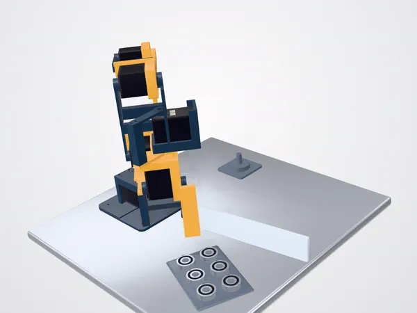
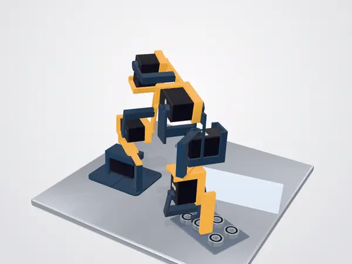

# Designing with ink

You tell an AI agent what you need, and it designs the part in ink. You
don't need to write ink's language or read its raw answers. Each design
goes round one loop: **ask**, **look**, **check**, **make**. ink is in
beta: its language and answers may still change.

## Set it up

Connect your agent to ink.build with one command from the README's
[Try it](../README.md#try-it); another MCP client must support remote
servers with sign-in. ink.build is free up to a weekly limit, and each
ink call reports what is left.

To run ink on your own machine instead, start your agent in a new folder
and paste this:

> Clone ink from https://github.com/miracleworksco/ink and build it with
> `cargo build --release` (Rust 1.95 or newer). Put `target/release` on
> the PATH, run `ink assert examples/frames.ink` in ink's directory and
> show me the answer. Then add `ink mcp` as an MCP server for yourself.

The local build has no parts catalog, share links or printing.

## 1. Ask

Brief the agent as you would a designer, with every requirement
measurable: "sturdy" can't be checked; "at least 6 mm of material around
each hole" can.

> Design a 6061 aluminium pivot bracket: a 90 × 20 × 5 mm base with two
> M5 clearance holes 70 mm apart, and a 6 mm lug with an H8 bore for an
> 8 mm pin, 25 mm above the base's top face. At least 6 mm from each hole
> to the edge; under 40 g.

Hand over:

- **Drawings and datasheets**, not photos: a photo has no sizes.
- **The parts it mates with**, by brand and model number. On ink.build
  the agent searches a catalog of 27,000 real parts, which ink drew from
  what their makers publish. They are not the makers' CAD: check a
  critical size against the datasheet.
- **Fits and tolerances** ("H8/f7", "±0.1 mm"). ink can check every size
  a tolerance allows.
- **How it moves**, and **how it will be made**: material, process and
  the process's limits.

Then ask the agent to list every size it chose that you didn't give.
Those choices are yours to check.

## 2. Look

Ask for a picture every time: a model can be valid and still not be
what you meant. The agent can draw a part from any side, cut open, or at
any moment of its motion.

To see it in 3D, ask the agent to share it: the link opens in a browser,
where you can turn the model and watch it move. Sharing makes every file
in that version of the project public, given to the public domain
(CC0), and anyone with the link can remix it. Sharing again updates the
link; unsharing takes it down, but not copies already made.

## 3. Check: can you trust it?

Ask the agent to turn each requirement it can check into a **claim**,
which ink checks like a test checks code. Each answer is either
**guaranteed** (ink proved it, to the accuracy the answer states) or
**estimated** (ink measured it, and nothing bounds the error).

 

*The arm clears its guard (left). With a taller guard, the check shows
where and when the gripper hits it (right).*

| ink says | For your part | What to do |
|---|---|---|
| **holds**, guaranteed | The requirement is met. | Trust it, if the claim says what you meant. |
| **holds**, estimated | Met as measured. Masses, volumes and wall thicknesses are estimates. | Leave a margin, and check the number by hand where it matters. |
| **fails**, guaranteed | The requirement is broken. ink usually shows a point that breaks it, the moment it happens, or the value it found. | Look at where, then change the design or the requirement. |
| **fails**, estimated | A measured value missed its limit. | Check the number before you redesign. |
| **unknown** | ink couldn't decide, and stopped rather than guess. It often says what would decide it. | See below. |

Some reasons a claim is unknown: the design sits exactly on its limit
(decide your margin); a feature is smaller than ink looked (ask for a
finer cell size); a fit is finer than the claim's accuracy (ask for a
finer accuracy); the check ran out of time.

### Push back

A design passes only what it checks. Ask:

1. **"What did you check?"** Each claim in plain words, with its
   numbers.
2. **"What didn't you check?"** Strength, assembly order and how a part
   is held are common gaps; a minimum wall is not a strength check.
3. **"Guaranteed or estimated?"** Ask to see ink's own answers, not
   only a summary.
4. **"Over the whole motion?"** A guaranteed hold covers every moment;
   an estimate checked sampled moments only.
5. **"Is the tight fit checked on its own?"** By default the check that
   no two parts overlap passes a shaft 0.4 mm over its bore's diameter.
6. **"Is every part where it belongs?"** A part floating beside its
   shaft, or sunk into it, still loads cleanly.
7. **"Break it on purpose."** Change a size until a claim fails. A claim
   that can't fail checks nothing.

## 4. Make

Ask the agent to check what your process cares about: walls and holes it
can produce, overhangs for printing, and what a cutter can see from each
setup. ink doesn't check bridges, or whether a cutter of real width
fits. Then ask for the file:

- **STL or 3MF** to 3D print; 3MF keeps colours. ink reports whether the
  mesh is closed (watertight).
- **DXF**, a flat outline for laser or waterjet cutting.
- **GLB** for any glTF viewer, such as Blender. Moving parts move; a
  part whose shape changes over time is shown at one moment.

To print, ask for a quote from Slant 3D, a separate print company: its
prices for a few order sizes and lead times, in black PLA unless you ask
otherwise, for a part up to 219 mm on a side. You order and pay Slant 3D
directly; ink takes no money and keeps no address. Printing is an early
test and may change.

## What ink can't do yet

- **No STEP or other solid CAD formats.** A part you already have comes
  in as STL.
- **No drawings for a shop.** Send the mesh and your own drawing.
- **No strength, stiffness or heat simulation** in the open-source
  kernel. Size for them by hand or in your own tools, and keep the result
  as a claim ink can check, such as a minimum wall.
- **No printer slicing or toolpaths.**
- **Materials** are typical values: for a specific grade, give the agent
  its datasheet.
- **Optimizing and flow simulation** are not on ink.build yet.

On ink.build, ask your agent to send the ink team feedback on anything
that gets in your way.

## For the agent

The language reference is `ink spec` ([docs/IR.md](IR.md)): how to write
claims, and what every field of an answer means.
[docs/guide/walkthrough.md](guide/walkthrough.md) follows one project from
the first request to a part ready to make, with every model and answer.
[docs/CORE.md](CORE.md) says what ink's answers promise.
