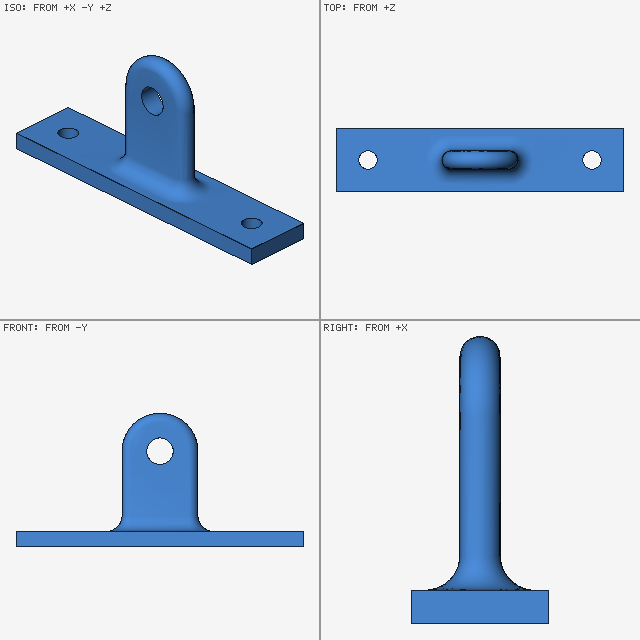
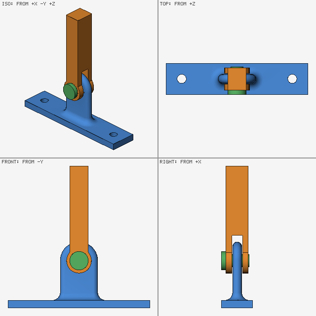

# A worked example: the pivot bracket

The agent's side of [the guide](../GUIDE.md): one project, a pivot
bracket with a lever swinging on it, from the first request to a part
ready to make, with each model the agent writes and each answer ink gives.
Every model and answer here is real: a test fails if ink starts answering
differently. Answers are cut to the keys that matter.

1. [What ink is for](#1-what-ink-is-for)
2. [Set it up](#2-set-it-up)
3. [Ask for a part](#3-ask-for-a-part)
4. [Read the answer](#4-read-the-answer)
5. [An assembly that moves](#5-an-assembly-that-moves)
6. [Can it be made?](#6-can-it-be-made)
7. [Sizing it](#7-sizing-it)
8. [Export](#8-export)
9. [What ink can't do yet](#9-what-ink-cant-do-yet)

## 1. What ink is for

A design states its requirements: this hole is 6 mm from the edge, these
parts never touch while the arm moves, the bracket weighs under 40 g.
Each one is a **claim**, and ink answers it **holds**, **fails** (with a
point that breaks it, the **witness**) or **unknown** (with what would
decide it). Each answer also has an **accuracy**: a number means proven
everywhere to within that size; `null` means an estimate, measured or
sampled, with no guaranteed bound.

Ink proves fits, clearances, edge distances, and collisions over a
motion where its search can decide them. It measures mass, volume and
wall thickness, checks whether a part can be made, and writes meshes and
cutting outlines.

## 2. Set it up

Set ink up as [the guide](../GUIDE.md#set-it-up) says. On connecting,
ink sends the agent a one-page tour of the language; the full reference
(`ink spec`) and the [examples](../../examples/README.md) are there when
it needs them. A local build works if the agent shows you this:

<!-- run -->
```sh
ink assert examples/frames.ink
```

```json
{"ok": true, "all_hold": true, "all_hold_guaranteed": true, "counts": {"holds": 4}}
```

## 3. Ask for a part

Brief the agent as you'd brief a designer, with every requirement a
number. A number can be checked; "sturdy" can't.

> Design an aluminium (6061) pivot bracket: a base 90 × 20 × 5 mm with
> two M5 clearance holes 70 mm apart, and in the middle an upright lug 24
> mm wide and 6 thick, round at the top, with an H8 bore for an 8 mm pin
> (an H8/f7 running fit), its centre 25 mm above the base's top face. Put
> a 5 mm fillet where the lug meets the base. Keep at least 6 mm of
> material between each hole and the edge of the base. It must weigh
> under 40 g.

The agent writes:

<!-- file bracket.ink -->
```lisp
(import "std")                                    ; the standard library: box, cylinder, fillets ...
(param hole 5.5)                                  ; M5 clearance, mm
(param thick 5)                                   ; the base's thickness
(param lug-w 24)                                  ; the lug's width
(param pivot-h 25)                                ; the bore's centre above the base's top face
(def plate (move (box 90 20 thick) 0 0 (/ thick 2)))   ; the base, its underside on z = 0
(def bore-z (+ thick pivot-h))
(def outline (min (move (rect-2d (- lug-w 6) bore-z) 0 (/ bore-z 2) 0)   ; the lug's outline, 3 in from its edge,
                  (move (circle-2d (- (/ lug-w 2) 3)) 0 bore-z 0)))       ; drawn in x and z, round at the top
(def lug (- (len2 (max (warp outline x z 0) 0) y) 3))   ; a plate 6 thick, every edge rounded 3: my choice
(def holes (min (move (cylinder-z (/ hole 2) 50) -35 0 0)
                (move (cylinder-z (/ hole 2) 50) 35 0 0)))
(def bore (move (cylinder-y 4 20) 0 0 bore-z))    ; H8: 8.000 to 8.022; drawn at 8.000, its tightest
(body bracket
  (shape (subtract (max (fillet-union (tag base plate) lug 5 90) (neg z))   ; the 5 mm fillet
                   holes bore))
  (attr material "aluminum-6061")                 ; 6061-T6 assumed: ink's values (yield 276 MPa) are T6's
  (frame pivot (at (rot-x 90) (move 0 0 bore-z))))    ; where a lever will turn: the bore's axis, mid-lug
(param edge 6)                                    ; the requirement: 6 mm from hole to edge
(def outside (neg (box 90 20 100)))               ; everything outside the base's outline
(assert edge-distance (clearance (max holes plate) outside edge))
(assert light (integral bracket (attr density) < 40))   ; the mass, in g
```

A `param` is a dimension the agent can try at other values without
editing the file. An `assert` is one requirement, named in the answers.
The comments after `;` are the agent's notes, and their assumptions are
yours to check. Here the
bore is drawn at the smallest size H8 allows, the lug's edges are rounded
3 mm (not in the brief), and "6061" is read as 6061-T6. A 6061-O part
would yield at about 55 MPa, not 276.

Ask the agent to load it and draw it:

<!-- run -->
```sh
ink check bracket.ink
```

```json
{"ok": true, "params": [{"name": "hole", "value": 5.5}, {"name": "thick", "value": 5},
                        {"name": "lug-w", "value": 24}, {"name": "pivot-h", "value": 25}, {"name": "edge", "value": 6}],
 "warnings": []}
```

<!-- run -->
```sh
ink render bracket.ink --out bracket.png --size 640 --res 0.15
```

```json
{"ok": true, "out": "bracket.png"}
```



Always look at the picture. A model can load cleanly and still not be
what you meant.

## 4. Read the answer

Ask the agent to show you ink's answers as ink gave them, not only its
summary. Asked whether the requirements hold, ink answers:

<!-- run -->
```sh
ink assert bracket.ink
```

```json
{"ok": true, "all_hold": true, "all_hold_guaranteed": false,
 "asserts": [{"name": "edge-distance", "status": "holds", "accuracy": 0.05,
              "claim": "(clearance (max holes plate) outside edge)", "source": "bracket.ink:21"},
             {"name": "light", "status": "holds", "accuracy": null, "integral": {"estimate": 36.2}}]}
```

`edge-distance` is proven. Ink searched all of space and showed that no
point of the holes comes within 6 mm of the outside. The 6 mm is exact:
ink never passes a 5.99 mm gap. The 0.05 is how fine the search went, so
a true gap within about 0.05 of 6 mm would come back `unknown`, never
wrong.

`light` is an estimate. Ink measured 36.2 g on a grid of cells, refining
the cells until the answer stopped moving, and nothing bounds its error.
That is why `all_hold` is true and `all_hold_guaranteed` is false. By
hand: 13,030 mm³ before the fillet, about 330 for it, at 0.0027 g/mm³, is
36.1 g, which agrees.

### When it fails

Require 7.5 mm from hole to edge. The holes' rims are 7.25 mm from the
edges (10 − 2.75 across the base), so the claim should fail:

<!-- run -->
```sh
ink assert bracket.ink --param edge=7.5
```

```json
{"ok": true, "all_hold": false,
 "asserts": [{"name": "edge-distance", "status": "fails", "accuracy": 0.05, "gap": 7.375,
              "witness_pair": {"in_first": [-35.0, 2.6875, 0.641], "in_second": [-35.0, 10.0625, 0.641]}}]}
```

The witness is two real points 7.375 mm apart, one in the left hole and
one just past the base's side, so the failure is proven. `gap` is how
close that pair came, not the smallest gap: the search stops at the first
pair closer than 7.5. To measure the smallest, the agent asks for a
distance, which comes back as a range, at least 7.2 (proven) and at most
7.25 (two real points are that far apart):

<!-- run -->
```sh
ink distance bracket.ink --a holes --b outside
```

```json
{"ok": true, "distance": {"lower_proven": 7.2, "upper_witness": 7.25}}
```

### When it doesn't know

Require exactly 7.25 mm, the true distance:

<!-- run -->
```sh
ink assert bracket.ink --param edge=7.25
```

```json
{"ok": true, "all_hold": false,
 "asserts": [{"name": "edge-distance", "status": "unknown", "accuracy": null,
              "accuracy_asked": 0.05, "accuracy_attained": 0.012}]}
```

The claim is true with nothing to spare, and a search in finite steps
can't prove a margin of zero. Ink got to within 0.012 mm and stopped
rather than guess; its `hint` says what would decide it. What to ask for
depends on why a claim is unknown:

| Why it's unknown | What to ask for |
|---|---|
| the design sits on its requirement | decide the margin, and change the design or the number |
| the accuracy is coarser than the feature (a thin wall, a fine fit) | a finer accuracy on that claim |
| a contact or overlap over a motion or a tolerance band | a claim on the sizes or positions instead, which can be proven |
| interference leaves a pair undecided (`undecided_pairs`) | a claim on that pair, at a finer accuracy |

### Did my agent get it right?

Read each answer as [the guide's table](../GUIDE.md#3-check-can-you-trust-it)
says, and ask what its [Push back](../GUIDE.md#push-back) lists. Here:
the agent chose the lug's rounded edges, 6061 as T6 and the bore at its
tightest; "25 mm above the base" could be from its underside, so the brief
says "top face"; a clearance is a distance, so a fit's is per side, not on
the diameter; and the 7.5 mm edge distance above is the claim broken on
purpose.

## 5. An assembly that moves

> Add a 60 mm aluminium lever that turns on the lug: a fork, its two
> cheeks 4 mm thick either side of the lug, on a steel 8 mm shoulder pin
> with a 12 mm head. It swings from level, up and over, to level on the
> other side in one second. It must stay at least 5 mm above the base all
> the way round. The pin is f7, pressed into the fork, and runs in the
> bracket's H8 bore.

The agent writes the two parts. Each has **frames**, a point and a
direction on the part, and parts are placed by where their frames meet.

<!-- file parts.ink -->
```lisp
(import "bracket.ink")
(def cheek (min (move (box 60 12 4) 30 0 0) (cylinder-z 8 4)))   ; one side of the fork: a Ø16 eye, my choice
(body lever                                       ; a fork: two 4 mm cheeks either side of the lug, its axis z
  (shape (subtract (min (move cheek 0 0 5.2) (move cheek 0 0 -5.2)  ; 0.2 clear of each face of the 6 mm lug
                        (move (box 44 12 14.4) 38 0 0))              ; joined beyond the lug's round top
                   (cylinder-z 3.9935 20)))       ; the pin pressed in: drawn line on line
  (attr material "aluminum-6061")
  (frame axis (at))                               ; on its axis, mid-way between the cheeks
  (frame front (at (move 0 0 7.2))))              ; the front cheek's outer face, under the pin's head
(body pin                                         ; f7: Ø7.972 to 7.987; drawn at 7.987, its largest
  (shape (min (move (cylinder-z 6 3) 0 0 1.5) (tag shank (move (cylinder-z 3.9935 15) 0 0 -7.5))))
  (attr material "steel")
  (frame seat (at (rot-x 180))))                  ; under its head
```

Then the assembly, with the motion and the requirements:

<!-- file swing.ink -->
```lisp
(import "parts.ink")
(t-span 0 1)                                      ; the motion lasts 1 s; t is time
(assembly root
  (instance b bracket)
  (instance lever lever (frame-of b pivot)        ; the fork's axis on the bore's
    (turn z (* 180 t)) (limits 0 180))            ; a joint: 180 degrees a second, 0 to 180 allowed
  (instance pin pin (frame-of lever front) seat))
(assembly at-rest                                 ; the same parts, the lever at 0
  (instance b bracket)
  (instance lever lever (frame-of b pivot))
  (instance pin pin (frame-of lever front) seat))
(assert fork-clears-lug (clearance (shape-of root/lever) (shape-of root/b) 0.15))
(assert clears-base (clearance (shape-of root/lever) (shape-of root/b base) 5))
(assert pin-held (touches (shape-of root/pin) (shape-of root/lever)))
(assert pin-fit (clearance (shape-of at-rest/pin shank) (shape-of at-rest/b) 0.006)   ; per side
  (accuracy 0.0002))
```

The joint's limits add a claim of their own, `limits:root/lever`. The
agent added `pin-held` unasked: a pin beside the fork, or sunk into it,
fails it. For the fit, H8/f7 leaves 0.0065 to 0.025 mm a side; the agent
drew the smallest bore and the largest pin and claims 0.006 a side at an
accuracy fine enough to see it, so every pair within the tolerances
clears. It checks the fit at rest because the pin turns about the bore's
own axis, so the gap is the same at every angle. That reasoning is the
agent's, not ink's, so it should tell you. It should also say what's
outside the brief: nothing keeps the pin from sliding out yet, and
nothing checks the parts for strength.

The agent checks the new file's own claims:

<!-- run -->
```sh
ink assert swing.ink --own
```

```json
{"ok": true, "all_hold": true, "all_hold_guaranteed": true,
 "asserts": [
   {"name": "limits:root/lever", "status": "holds", "accuracy": 0, "motion": {"how": "t ranged"}},
   {"name": "fork-clears-lug", "status": "holds", "accuracy": 0.05, "motion": {"how": "t ranged"}},
   {"name": "clears-base", "status": "holds", "accuracy": 0.05, "motion": {"how": "t ranged"}},
   {"name": "pin-held", "status": "holds", "accuracy": 0.05, "motion": {"how": "t ranged"}},
   {"name": "pin-fit", "status": "holds", "accuracy": 0.0002}]}
```

Read `motion.how` on every claim over a motion. `t ranged` means time was
searched like any other dimension, so the claim is proven at every moment
of the swing. `measured` means ink checked sampled moments and proves
nothing between them, so the accuracy is `null`; a contact between parts
moving against each other gets this, and its `hint` says why. The limit's
accuracy `0` means exact: a claim on an angle or a ratio is exact unless
it asks for an accuracy in its own units.

The other check for an assembly is **interference**, no two parts
overlapping anywhere:

<!-- run -->
```sh
ink interfere swing.ink
```

```json
{"ok": true, "accuracy": 0.1, "overlapping_pairs": 0, "undecided_pairs": 0,
 "pairs": [{"pair": ["root/b", "root/lever"], "status": "holds", "accuracy": 0.1,
            "motion": {"how": "t ranged", "span": [0, 1]}},
           {"pair": ["root/b", "root/pin"], "status": "holds", "accuracy": 0.1,
            "motion": {"how": "t ranged", "span": [0, 1]}},
           {"pair": ["root/lever", "root/pin"], "status": "holds", "accuracy": 0.1}]}
```

Every pair is proven clear through the whole swing. Touching is not
overlapping, so the pin pressed into the fork passes. Interference lets
through an overlap no deeper than its accuracy, so a shaft up to 0.4 mm
over its bore's diameter would pass: a fine fit needs its own claim, as
`pin-fit` is.

To see it half way through the swing:

<!-- run -->
```sh
ink render swing.ink --out swing.png --t 0.5 --size 640 --res 0.15
```

```json
{"ok": true, "out": "swing.png"}
```



If the lever overruns and keeps turning for 1.2 s:

<!-- run -->
```sh
ink assert swing.ink --own --t-span 0:1.2
```

```json
{"ok": true, "all_hold": false,
 "asserts": [
   {"name": "limits:root/lever", "status": "fails", "accuracy": 0, "t": 1.05, "terms": {"drive": 189}},
   {"name": "fork-clears-lug", "status": "fails", "accuracy": 0.05, "t": 1.125, "gap": 0.127},
   {"name": "clears-base", "status": "fails", "accuracy": 0.05, "t": 1.125, "gap": 3.13},
   {"name": "pin-held", "status": "holds"},
   {"name": "pin-fit", "status": "holds"}]}
```

Each failure gives a moment `t` that fails. The lever is past its 180°
limit at 1.05 s, and by 1.125 s within 5 mm of the base and the fork
within 0.15 mm of the lug. A witness is a real pair of points at a
real moment, so each failure is proven.

## 6. Can it be made?

> The lever pulls straight up on the pin with up to 500 N: is the
> bracket strong enough? It'll be milled from 6061 bar on a 3-axis mill,
> in setups from the top and the side. Check that it can be made: no wall
> under 0.8 mm, and no hole under 2.5 mm, the shop's smallest cutter.

Ink answers only the second question, and a good agent says so first:

> I can't check strength with ink. By hand, the base between the lug and
> each screw is a short beam carrying 250 N over 18 mm, about 27 MPa at
> its surface: a tenth of 6061-T6's yield, before the fillet's stress
> peak. Treat this as an estimate and have it simulated before you rely
> on it.

The agent writes the shop's rules as claims:

<!-- file make.ink -->
```lisp
(import "bracket.ink")
(def part (shape-of bracket))
(def stock (move (box 90 20 (+ bore-z 12)) 0 0 (/ (+ bore-z 12) 2)))   ; the bar it's cut from: the base's outline, the lug's height
(def air (clear-air part stock 0.5))              ; what the mill removes: the bar's air, 0.5 clear of the part
(def through-lug (move (cylinder-y 5 6) 0 0 bore-z))   ; round the bore, through the lug
(assert top-reaches (empty (hidden part stock (max air (neg through-lug)) (vec (vec 0 0 1)))))   ; setup 1, from the top: all but the bore
(assert side-reaches (empty (hidden part stock (max air through-lug) (vec (vec 0 1 0)))))        ; setup 2, on its side: the bore
(assert walls (min-thickness part > 0.8))         ; no wall under 0.8 mm
(assert holes (min-thickness (air-around part 10) > 2.5))   ; no hole or gap under 2.5 mm across
```

<!-- run -->
```sh
ink assert make.ink --own
```

```json
{"ok": true, "all_hold": true, "all_hold_guaranteed": false,
 "asserts": [{"name": "top-reaches", "status": "holds", "accuracy": 0.05},
             {"name": "side-reaches", "status": "holds", "accuracy": 0.05},
             {"name": "walls", "status": "holds", "accuracy": null, "value": 5},
             {"name": "holes", "status": "holds", "accuracy": null, "value": 5.5}]}
```

The two setups are proven: every bit of the bar's air is in sight of a
cutter from one or the other. A single setup from the top would fail,
with a witness inside the bore, which runs sideways. The proof covers
undercuts deeper than about 0.6 mm (the claim's 0.5 plus twice the
accuracy).

The walls and holes are measured. Ink casts rays inward from samples of
the surface: the thinnest wall it found is the 5 mm base, the narrowest
hole a 5.5 mm screw hole. A wall thinner than the samples' spacing could
slip between them; a smaller cell size on the claim, `(res r)`, looks
closer.

Not checked: whether a cutter fits (a line of sight has no width), inside
corners round enough for the cutter, how the part is held, and strength.
examples/machining-access.ink, mould-undercut.ink and print-checks.ink
show the same kind of claims for other processes.

## 7. Sizing it

To change a part against all its requirements at once, the agent collects
the claims in one file and tries params on the command line (`--param
thick=4`). For more than two or three params it writes an `(optimize
...)`: params varied inside bounds, a mass or volume to minimize, and
claims as its requirements ([Optimization](../IR.md#optimization)). The
design it returns is one to check with `ink assert`, not a proof.

A size with a tolerance can be checked over its whole **band**, every
size the tolerance allows. Ask to prove the H8/f7 pin runs free at every
size, and the agent gives each size its band:

<!-- file fit.ink -->
```lisp
(import "std")
(param bore-d 8 (tol 0 0.022))                    ; H8: 8.000 to 8.022
(param pin-d 7.9795 (tol -0.0075 0.0075))         ; f7: 7.972 to 7.987
(body eye (shape (subtract (cylinder-z 8 6) (cylinder-z (/ bore-d 2) 10))))
(body pin (shape (cylinder-z (/ pin-d 2) 12)))
(assert runs-free (clearance (shape-of pin) (shape-of eye) 0.006) (accuracy 0.0002))   ; per side
```

<!-- run -->
```sh
ink assert fit.ink
```

```json
{"ok": true, "all_hold_guaranteed": true,
 "asserts": [{"name": "runs-free", "status": "holds", "accuracy": 0.0002,
              "param_spans": {"bore-d": [8.0, 8.022], "pin-d": [7.972, 7.987]}}]}
```

Proven for every bore and pin in the bands at once. The value written is
a real size inside the band: written as 8 with deviations, the pin's
value would be a size no real f7 pin has, and `ink check` warns. A mass
is estimated at sizes spread across a band. A claim that needs a size as
one fixed number is refused, with how to check it instead.

## 8. Export

To 3D print, ask for STL or 3MF:

<!-- run -->
```sh
ink mesh bracket.ink --out bracket.stl
```

```json
{"ok": true, "objects": [{"target": "bracket", "watertight": true}]}
```

`watertight` means a closed mesh, ready for a slicer. `deviation.max` is
how far the mesh strays from the true surface, sampled: a measurement,
not a bound. The same STL can go to your own simulation tool. GLB carries
the whole assembly, with the lever moving, to any glTF viewer. DXF is a
flat outline for laser or waterjet cutting.

## 9. What ink can't do yet

Beyond [the guide's list](../GUIDE.md#what-ink-cant-do-yet):

- **No faces or edges** to point at. Agents name the pieces they build
  (`tag`) and the frames parts meet at.
- **Measured, not proven:** masses, volumes, wall thickness, hole sizes,
  claims against an imported mesh, and claims over a motion the search
  couldn't decide.
- **Freeform surfaces** are limited to what formulas and the standard
  library's curves and sweeps describe.
- **Materials** come from a short list of typical values
  (std/materials.ink).

[docs/CORE.md](../CORE.md) says what ink's answers promise, and
[docs/IR.md](../IR.md) (`ink spec`) is the language reference.
