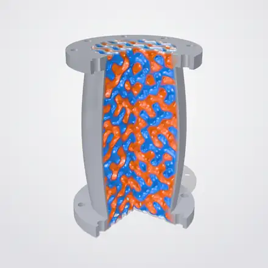
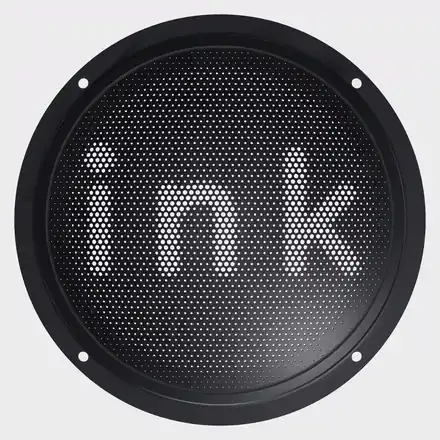
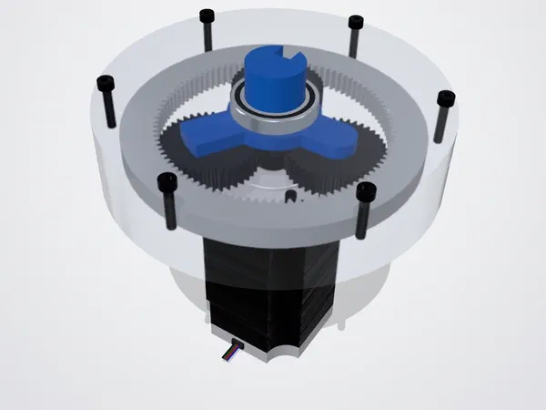
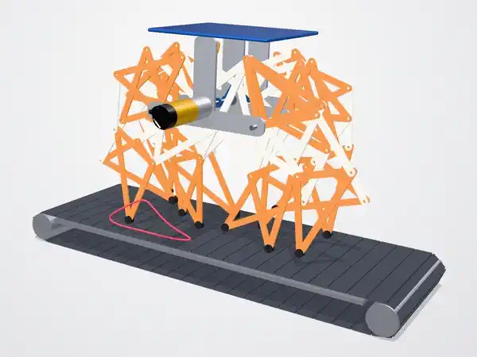
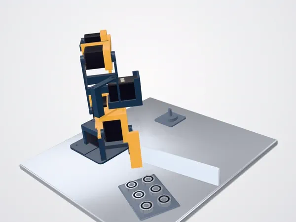
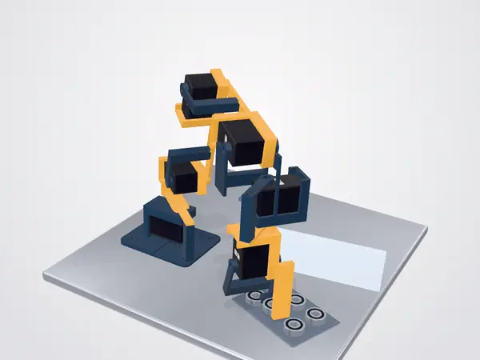

<picture>
  <source media="(prefers-color-scheme: dark)" srcset="https://ink.build/brand/header.svg?theme=dark">
  
</picture>

**An open-source implicit CAD kernel for agents.**

## What you can do with it

### Lattices and blends

Gyroids, graded lattices and thousands of holes are each a line of code.

 

### Assemblies that move

Joints, linkages and gear trains in motion, checked for collisions.

 

### Proven checks

Clearance and collision checks can prove a claim over the whole motion.
A geometric counterexample gives a point and, for a moving pair, a moment.

 

### Export

STL, 3MF and GLB meshes, and DXF outlines to cut. More formats are coming.

### Simulation

Strength, stiffness, vibration and heat studies on the field itself, with
no mesh; topology layouts; and the efforts a motion asks of its motors. Every answer says how it was found and how far to
trust it.

## What's in the box

- `ink`: the command line and MCP server
- [Simulation packages](../sim/): studies, topology and dynamics, in
  an `ink` built with them
- The `.ink` language and its standard library: gears, threads, belts,
  lattices, sheet metal and more
- [Examples](examples/), [demos](demos/) and [benchmarks](benchmarks/)
- [What ink's answers promise](docs/CORE.md)
- [Facts, ratings and requirements](docs/CLAIMS.md): how a design asks
  whether its parts are within their ratings
- [Contributing](CONTRIBUTING.md)

## Try it

[ink.build](https://ink.build) runs ink and has 27,000 real parts to
build with.

####  Claude Code

<!-- not run: it changes your agent's settings -->
```sh
claude mcp add --transport http ink https://ink.build/mcp
```

#### <picture><source media="(prefers-color-scheme: dark)" srcset="https://cdn.jsdelivr.net/npm/@lobehub/icons-static-png@2.6.0/dark/openai.png"></picture> Codex

<!-- not run: it changes your agent's settings -->
```sh
codex mcp add ink --url https://ink.build/mcp
```

#### Any other MCP client

If it supports remote servers with sign-in, add:

<!-- not run: an address -->
```text
https://ink.build/mcp
```

Then ask your agent for a part. The [guide](docs/GUIDE.md) shows how to
direct it.

To run ink yourself instead, build it (Rust 1.95 or newer) and add
`target/release/ink mcp` to your agent as a local MCP server:

<!-- not run: it builds the binary the tests run -->
```sh
cargo build --release
```

For the simulation packages too, build ext's `ink` instead
(`../sim/target/release/ink`):

<!-- not run: it builds the binary the tests run -->
```sh
cargo build --release --manifest-path ../sim/Cargo.toml
```

## License

MIT. See [LICENSE](LICENSE).
